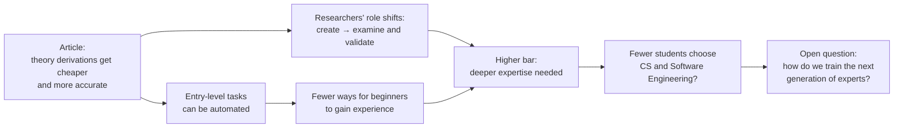

# AI Disruption & Falling Costs in Theory Research — Personal Reflection

**What happens to the next generation of researchers and developers when AI makes theoretical research cheaper and raises the bar for entering the field?**

A personal reflection on the preprint *AI Disruption and Falling Costs in Theory Research* (Manso, Verdun & Thompson, MIT), written for the **Human Interactions with AI** course at **HIT — Holon Institute of Technology**.

[**📝 Reflection (EN)**](docs/personal-reflection-en.pdf) · [**📝 Reflection (HE)**](docs/personal-reflection-he.pdf) · [**🧭 Key Takeaways**](docs/key-takeaways.md) · [**📖 The Article**](https://futuretech.mit.edu/publication/ai-disruption-and-falling-costs-in-theory-research)

---

## 🧭 Why This Topic Matters

The article measures how fast AI is getting better at deriving results from recent theory papers, and how little each attempt costs. This reflection takes that finding one step further and asks a personal question:

> If AI raises the level of knowledge and skills required to enter technological professions, could fewer people choose to study these fields in the first place?

> This repository documents a student's personal reflection on a published preprint. It does not claim authorship of the article, original experiments, or new research findings. The views expressed are interpretation and opinion, not the conclusions of the article's authors.

## 📄 The Article at a Glance

The authors test whether AI models reach the same conclusions as human authors of 254 recent arXiv theory papers (posted Dec 2025 – May 2026, after the models' knowledge cutoffs), across seven fields: analysis of PDEs, probability, statistics theory, economic theory, high-energy theory, gravitation and cosmology, and quantum physics. Six OpenAI model releases, from o1 (Dec 2024) to GPT-5.5 (Apr 2026), are run through the same agentic pipeline and graded against rubrics derived from the human papers.

| Measure | o1 (Dec 2024) | GPT-5.5 (Apr 2026) |
|---------|---------------|--------------------|
| **Answers receiving full marks** | 2.8% (7 / 254) | 34.6% (88 / 254) |
| **Mean score (partial credit included)** | 29.9% | 69.1% |
| **Cost per full-mark answer** | $170.34 | $15.06 |
| **Cost per attempt** | $4.69 | $5.22 |

A few other points the article makes:

- Gains appear in **every field studied**, at roughly 2.0–2.6 score points per month.
- Progress is **not monotonic**: some releases lose answers earlier ones got right, which the authors link to a "jagged frontier."
- The cost estimate covers model spending only. It **excludes human labor and independent verification**.
- The discussion warns that if derivation gets cheaper faster than verification, **choosing questions and establishing reliable answers** may become the real bottlenecks.
- The authors list their own limits: an LLM grader (GPT-5.5), a human review of only five problems, a single documented pipeline, and OpenAI-provided compute credits for the study.

For the exact claims, methods, and caveats, please read the article itself.

## 🗺️ From the Article to the Reflection



| Stage | Question the reflection raises |
|-------|--------------------------------|
| **Researchers** | What happens to a researcher's professional identity when AI does part of the work that defined it? |
| **Entry-level developers** | Where do beginners gain experience if AI handles the tasks they used to learn from? |
| **The entry bar** | Will a bachelor's degree remain enough, or will advanced expertise become the baseline? |
| **Enrollment** | Would a young person still choose this path knowing the bar keeps rising? |
| **The pipeline** | If we need experts to challenge AI, how do we train the next generation of them? |

The reflection's focus on **verification** echoes the article's own discussion of verification costs. Its focus on **entry-level developers and enrollment** goes beyond what the article studies and is the author's own extension.

## 🔍 What the Reflection Explores

| Lens | Questions followed |
|------|--------------------|
| **Role change** | Does research shift from creating knowledge to verifying it? What happens to human creativity, innovation, and curiosity? |
| **Skills** | What does it take to critically evaluate AI output: understanding assumptions, checking proofs, spotting logical flaws, challenging conclusions? |
| **Perception** | How do students and lecturers see the future of the profession, and what do conversations on campus suggest about enrollment? |
| **Training** | How can the next generation keep learning and becoming experts when the earliest steps are automated? |

The reflection is written from the perspective of a Computer Science student at the start of his master's studies, and it says plainly that campus conversations are anecdotal and not evidence of a global trend.

## 📚 Materials

| Resource | Purpose |
|----------|---------|
| [📝 Reflection, English (PDF)](docs/personal-reflection-en.pdf) | The full reflection, formatted for reading and sharing |
| [📝 Reflection, Hebrew (PDF)](docs/personal-reflection-he.pdf) | The original Hebrew version |
| [📄 Markdown, English](docs/personal-reflection-en.md) · [Hebrew](docs/personal-reflection-he.md) | Same text, readable directly on GitHub |
| [🧭 Key takeaways](docs/key-takeaways.md) | A concise summary of the article's main results and the reflection's ideas |

## 🎓 Academic Context

**Course:** Human Interactions with AI  
**Institution:** HIT — Holon Institute of Technology  
**Author of the reflection:** Shlomi Hazan

## 📖 The Article

**AI Disruption and Falling Costs in Theory Research** (preprint)  
Gabriel Manso (MIT EECS, MIT FutureTech), Claudio Mayrink Verdun (MIT FutureTech), Neil Thompson (MIT FutureTech)

Published on the MIT FutureTech site on October 13, 2026:

- [🔗 Publication page (MIT FutureTech)](https://futuretech.mit.edu/publication/ai-disruption-and-falling-costs-in-theory-research)
- [📄 Full paper (PDF)](https://drive.google.com/file/d/1xpX-NsROKED7Pp3E5IwWIOehF7M2rx7y/view?usp=sharing)

This repository is a student reflection on that article. The article itself is not redistributed here; please use the links above.

> Sometimes the most interesting question a paper raises is not about the research, but about who gets to do it next.

## 📂 Repository Structure

```
.
├── README.md
├── assets/                  # images and visuals
└── docs/
    ├── key-takeaways.md
    ├── personal-reflection-en.md
    ├── personal-reflection-en.pdf
    ├── personal-reflection-he.md
    └── personal-reflection-he.pdf
```
